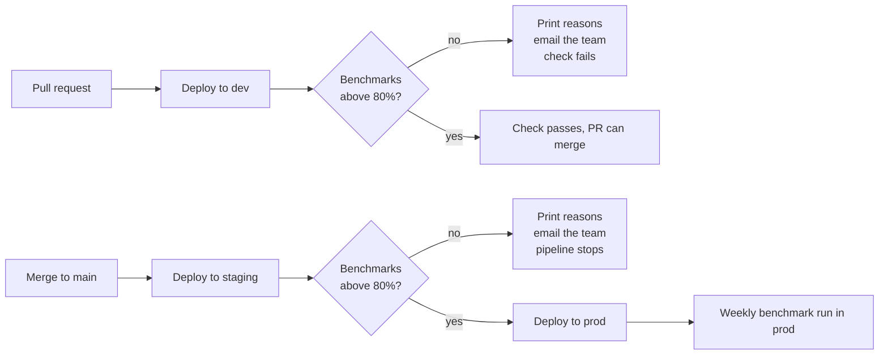

# Genie Agent CI/CD example

Deploy a Genie Agent from Git through **dev, staging and prod**, with its **benchmarks deployed alongside it** and a
**benchmark gate** in the pipeline. The agent reaches prod only after a merge to `main`, and only if benchmark accuracy is
**above 80%**. If it is not, the pipeline prints each failing question with its reason, emails the team, and stops.



## What is in here

| Path | What it does |
| --- | --- |
| `databricks.yml` | Bundle with the `dev`, `staging` and `prod` targets. Each target points at its own catalog (`dev`, `staging`, `prod`). |
| `resources/sales_agent.genie.yml` | The Genie Agent as code: tables, column settings, instructions, example SQL, joins, measures and **20 benchmark questions** (10 questions, 2 phrasings each). |
| `resources/benchmark_gate.job.yml` | Serverless job that runs the benchmarks and fails below the threshold. Email on failure goes to `alert_email`. In prod it also runs weekly. |
| `src/benchmark_gate.py` | Starts a benchmark evaluation run, waits for it, prints accuracy and the reason for each failing question, and fails the run when accuracy is not above `min_accuracy`. |
| `scripts/run_gate.sh` | Used by CI: runs the gate job, prints its report in the CI log and the GitHub job summary, and exits non-zero on failure. |
| `scripts/pull_agent.py` | Pulls changes you made to your dev agent in the UI back into `sales_agent.genie.yml`. |
| `scripts/seed_demo_data.py` | Example only: creates the `customers` and `orders` tables from `samples.tpch` in each environment. |
| `.github/workflows/genie-pr.yml` | Pull request: deploy to dev, run the benchmarks. |
| `.github/workflows/genie-release.yml` | Merge to `main`: deploy to staging, run the gate, then promote to prod. |

## One definition, three environments

Table names in the agent are written as `${var.catalog}.${var.schema}.orders`. Each target sets its own catalog, so the
same file deploys as `dev.genie_sales.orders` in dev, `staging.genie_sales.orders` in staging and `prod.genie_sales.orders`
in prod. You keep one agent definition in Git and test it against dev and staging data before it ever points at prod data.

The agent is defined inline in YAML (`serialized_space`), not in a `.geniespace.json` file, because bundle variables are
resolved in YAML but not inside an included JSON file.

## How the gate decides

The benchmarks are part of the agent definition, so every deployment ships the current benchmark set. After each
deployment the gate:

1. starts a benchmark evaluation run on the deployed agent (Genie benchmark API, Beta);
2. waits until the run finishes;
3. computes accuracy as correct answers divided by benchmark questions; answers marked *needs review* count as not correct;
4. passes only when accuracy is **above** `min_accuracy` (default `80`, set in `databricks.yml`).

On failure the report looks like this, in the CI log, in the GitHub job summary and in the failure email:

```
GENIE BENCHMARK GATE  FAILED
Agent: Sales Analytics   Target: staging
Accuracy: 75.0% (15/20 correct)   Required: above 80%
 1. [BAD] Who were the top 5 customers by revenue in 2025?
    Reason: rows are missing compared with the expected result
```

Because the release workflow's `prod` job `needs: staging`, a failed gate means prod is never deployed.

## Set up

1. **Environments.** Create the catalogs `dev`, `staging` and `prod` (or change the names in `databricks.yml`) and a
   serverless SQL warehouse in each workspace. One workspace or three both work.
2. **Service principals.** Create one service principal per environment, with `USE CATALOG`, `USE SCHEMA`, `CREATE TABLE`
   and `SELECT` on its catalog and `CAN USE` on the warehouse.
3. **Sign-in without secrets.** For each service principal, create a
   [GitHub Actions federation policy](https://docs.databricks.com/aws/en/dev-tools/auth/provider-github). Use the entity
   type *Environment* and the subjects `repo:<org>/<repo>:environment:dev`, `...:staging` and `...:prod`.
4. **GitHub environments.** Create the environments `dev`, `staging` and `prod`, each with these variables:
   `DATABRICKS_HOST`, `DATABRICKS_CLIENT_ID` (the service principal's application ID) and `WAREHOUSE_ID`. Add required
   reviewers on `prod` if you want a manual approval before promotion.
5. **Alert email.** Add the repository secret `GENIE_ALERT_EMAIL` with the address or distribution list that should get
   the failure email. It is kept out of the code.
6. **Branch protection.** On `main`, require the status check **Genie benchmarks (dev)**, so pull requests cannot merge
   while the gate fails.
7. Copy the contents of this folder to the root of your repository and push.

## Develop an agent change

```bash
# deploy your own dev copy (resources get a "[dev <you>]" prefix)
databricks bundle deploy -t dev --var warehouse_id=<id>

# tune the agent in the Genie UI, then pull the changes back into Git
python scripts/pull_agent.py --space-id <your dev agent id> --catalog dev

# run the gate yourself before opening a pull request
scripts/run_gate.sh dev
```

Add a benchmark question for every new question pattern the agent should answer, with the SQL you expect.

## Use it with your own agent

- Export an existing agent: `databricks bundle generate genie-space --existing-id <id> --key my_agent`, then move the
  generated `serialized_space` into a resource YAML file and replace the catalog and schema with `${var.catalog}` and
  `${var.schema}` (or run `scripts/pull_agent.py`).
- Point `space_id` in `resources/benchmark_gate.job.yml` at your agent's resource key.
- Remove the seed step from the workflows: in your project, data pipelines own the tables. The tables must exist before
  the first deployment of an agent.

## Notes

- `genie_spaces` needs the direct deployment engine and Databricks CLI 1.3.0 or later
  ([docs](https://docs.databricks.com/aws/en/dev-tools/bundles/resources#genie_space)). This example was tested with
  CLI 1.17.0.
- The benchmark evaluation API is in Beta and may change.
- Users asking the agent are free through January 31, 2027; service principals, including the gate's benchmark runs,
  are billed. See [Genie cost](https://docs.databricks.com/aws/en/genie/monitor-cost).
